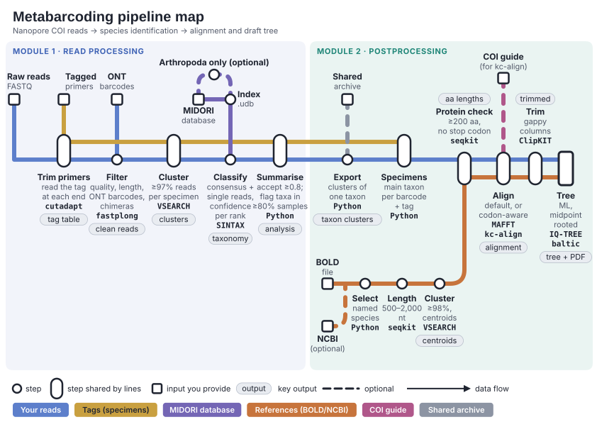

# Deadwood arthropod COI metabarcoding

This project generates COI barcode sequences of wood-associated arthropods collected
from deadwood. Each arthropod is processed individually: one specimen per DNA
extraction and PCR well. The pipeline turns the Oxford Nanopore (ONT) reads of all
specimens into an identification per specimen and, for each taxon of interest, a
**draft alignment and phylogenetic tree that a person then reviews**.
It is written for biologists: every step can be run by copying commands, and the
guides explain what each step does and what to check.

Open the [offline browser guide](docs/metabarcoding-guide.html) (double-click the
file; no internet or server needed) for a menu-driven version of these instructions
with copy buttons and a command builder.

## How specimens are recognised

Each sequencing **barcode folder** (`barcode01`, `barcode02`, … as written by MinKNOW)
holds the reads of one pool of PCR products. Inside a pool, each specimen was
amplified with a different **tagged forward primer** (`bc1001`–`bc1096`) and one of three
**tagged reverse primers** (`bc1100rc`, `bc1107rc`, `bc1122rc`). So one **specimen** is
one barcode folder + one forward tag.

## The pipeline at a glance



Read the map left to right. Each coloured line is one stream of data: your reads
(blue), the tags that identify specimens (yellow), the MIDORI classification database
(purple), the BOLD or NCBI reference sequences (orange), the optional COI guide for
kc-align (pink) and a shared archive for collaborators who only run Module 2 (grey).
Where lines run side by side through one step, that step uses both. Squares are files
you provide; grey pills are key outputs. The blue area is Module 1, the green area
Module 2.

| Module | What it does | Run it | Main result |
| --- | --- | --- | --- |
| **1 · Read processing** | For a whole sequencing run: finds the primers and tags of every read (which specimen it comes from), cleans the reads, clusters the nearly identical reads of each specimen (≥97%) into consensus sequences, and identifies every cluster with SINTAX against MIDORI. Summarises the results per specimen, species and sample, and flags taxa found in almost every sample. | once per sequencing run | an **analysis folder** |
| **2 · Postprocessing** | For one taxon (e.g. a family): takes its clusters from the analysis folder, keeps the main identification of each specimen, adds reference sequences of named species (BOLD or NCBI), checks that every sequence codes for protein, aligns, trims and builds a draft tree. | once per taxon | an **alignment and draft tree** to review |

The pipeline never makes the final scientific decisions. You decide which clusters
and reference species belong in the final tree.

## Before you start

1. Set up Ubuntu/WSL, Miniconda and the two software environments:
   [setup guide](docs/setup.md).
2. Download the classification database ([MIDORI](data/sintax/README.md)) for
   Module 1 and the reference database ([BOLD](data/bold/README.md)) for Module 2.
3. Put your raw reads in `data/DATASET/barcodeNN/` (one folder per barcode; `DATASET`
   is any name, e.g. `mergedseq7`).

Run every command from the project folder with the `taxonomy` environment active:

```bash
cd ~/metabarcoding
conda activate taxonomy
```

## Run Module 1 · Read processing

```bash
# Only if MinKNOW wrote pass/fail subfolders: combine them first.
python code/merge_pass_fail.py DATASET
# Preview what will run, then run.
python code/read_processing.py DATASET --dry-run
python code/read_processing.py DATASET --output-dir data/read_processing/DATASET_run01
```

All settings are in [`config/pipeline.env`](config/pipeline.env), each with a comment.
Classification is the slow step (about one second per cluster on 8 threads, up to a
day or more for a large barcode folder); everything else takes minutes. Finished
steps are reused when you run the command again. Details:
[Module 1 guide](docs/read_processing.md).

**Key outputs** of Module 1:

| File | What it is |
| --- | --- |
| `data/DATASET/barcodeNN/filtered/clusters.fasta` | The sequences that were classified: one consensus sequence per cluster of ≥2 reads, or the read itself. |
| `data/DATASET/barcodeNN/filtered/cluster_members.tsv.gz` | Which cleaned read belongs to which cluster. |
| `data/DATASET/barcodeNN/filtered/primer_tags.tsv.gz` | Tags and tag status of every raw read. |
| `ANALYSIS/specimen_taxa.tsv` | **Start here:** the identifications found in each specimen, with reads, and the largest one marked. |
| `ANALYSIS/barcodeNN/barcodeNN_clusters.tsv` | One row per cluster: read count, tags, taxonomy with confidences, contamination flag. |
| `ANALYSIS/all_species_summary.tsv`, `species_by_folder.tsv` | Species per sample, with reads, clusters and specimens. |
| `ANALYSIS/barcode_analysis_summary.tsv`, `primer_tag_summary.tsv` and `.png` figures | Quality checks per sample: reads kept, tags found, reads identified. |
| `ANALYSIS/taxon_barcode_prevalence.tsv` | The contamination screen. |
| `ANALYSIS/analysis.complete` | Written last; Module 2 only accepts a finished analysis. |

`ANALYSIS` is the analysis folder, e.g. `data/read_processing/DATASET_run01/analysis`.
Every column is explained in the [Module 1 guide](docs/read_processing.md#results).

## Run Module 2 · Postprocessing

**MAFFT** aligns by default. For COI, use **kc-align** instead (recommended): it
aligns codon by codon along a trusted COI guide sequence, which keeps the reading
frame intact. Add `--kcalign` and the guide
([how to choose one](docs/coi_reference.md)).

```bash
# Recommended for COI: kc-align with a COI guide.
python code/postprocess_sintax.py DATASET --bold --taxon Tipulidae \
  --analysis-dir data/read_processing/DATASET_run01/analysis \
  --output-dir data/postprocessing/Tipulidae_run01 \
  --kcalign --kcalign-reference data/postprocessing/coi_refs/COI_reference.fasta --threads 6

# Default: MAFFT (no guide needed).
python code/postprocess_sintax.py DATASET --bold --taxon Tipulidae \
  --analysis-dir data/read_processing/DATASET_run01/analysis \
  --output-dir data/postprocessing/Tipulidae_run02
```

Use `--folders barcode01 barcode15` instead of `DATASET` for some samples only, and
`--download` instead of `--bold` for NCBI references. If a run stops, fix the cause
and repeat the command with `--resume`. Details:
[Module 2 guide](docs/post_processing.md).

**Key outputs** of Module 2 (`*` = taxon and date, e.g. `combined_Tipulidae_nonumt_20261124`):

| File | What it is |
| --- | --- |
| `extraction_by_specimen_taxon.tsv` | Reads and clusters of the taxon per specimen, and which identification was kept for the tree. |
| `*.clipkit.aln.fasta` | The trimmed alignment the tree was built from: **check this first**. |
| `*.aln.fasta` | The alignment before trimming. |
| `*.figure.pdf` / `.png` / `.svg`, `*.figure.midpoint.nwk` | The draft tree, as a picture and as a rooted tree file. |
| `*.figure.tips.tsv` | What each tip is: a local cluster (with folder, tag, read count) or a reference (with its BOLD or GenBank ID). |
| `translation_lengths.tsv`, `*.kcalign_selection.tsv` | Why a sequence was left out (protein check, kc-align). |
| `postprocessing.log`, `postprocessing.complete` | Every command run, counts and errors; the second exists only when the run finished. |

Every file is described in the [output-file reference](data/postprocessing/README.md).
Then review the alignment and estimate the final tree:
[what to check](docs/post_processing.md#c-review-the-results).

## Run Module 2 from shared data (`postprocessing-inputs.tar.gz`)

Module 2 does not need the raw reads, the MIDORI database or the long classification
step: only the cluster tables and cluster sequences of a finished Module 1 analysis.
This lets a collaborator run Module 2 on their own computer.

**The person who ran Module 1** packs these files into `postprocessing-inputs.tar.gz`
with the commands in [Sharing Module 2 inputs](docs/sharing_postprocessing.md), and
tells the collaborator the analysis path.

**The collaborator**:

1. Follows the [setup guide](docs/setup.md) (only the `taxonomy` environment is needed)
   and prepares the [BOLD file](data/bold/README.md) (or uses `--download`, which needs
   internet) and, for kc-align, a [COI guide](docs/coi_reference.md).
2. Extracts the archive in the project folder (not inside `data/`):

   ```bash
   cd ~/metabarcoding
   tar --keep-old-files -xzf "/mnt/c/Users/USERNAME/Downloads/postprocessing-inputs.tar.gz"
   ```

3. Runs Module 2 as above, with `--analysis-dir` set to the path the sender gave.

## Documentation

| Guide | Read it when you want to… |
| --- | --- |
| [Setup](docs/setup.md) | install the software and get the project |
| [Module 1 · Read processing](docs/read_processing.md) | clean, tag, cluster and classify reads; understand the tables; export sequences |
| [Module 2 · Postprocessing](docs/post_processing.md) | build an alignment and a draft tree for one taxon, then review it |
| [Choosing a COI guide for kc-align](docs/coi_reference.md) | prepare the trusted reference sequence kc-align needs |
| [Sharing Module 2 inputs](docs/sharing_postprocessing.md) | send a collaborator what they need to run Module 2 without Module 1 |
| [Glossary](docs/glossary.md) | look up a term |
| [Presentation](docs/pipeline_presentation.html) | introduce the pipeline to others: a 70-minute talk (55 slides) with a worked example (open in a browser, works offline; N shows speaker notes) |
| [Module 2 output files](data/postprocessing/README.md) | find out what a file in a run folder contains |
| [Code overview](code/README.md) | see which script does what |

## Things to know before you start

- **Tags must be complete to be trusted.** A tag is assigned only when the read
  contains the whole tag with at most 4 errors and it clearly beats every other tag;
  otherwise the read is marked *ambiguous*, *too_many_errors* or *truncated*
  ([details](docs/read_processing.md#how-tags-are-identified)). Reads without a forward
  tag are grouped per barcode as specimen `none`, which can mix specimens.
- **Clustering keeps species apart.** Reads are merged only within one specimen and
  only when at least 97% identical. Do not lower this identity.
- **The BOLD database contains other markers** (16S, 28S, ITS, COI-3P, CYTB…). If you do
  not use kc-align with a COI guide, references of other markers can end up in the
  alignment ([details](data/bold/README.md#other-markers-in-the-bold-file)).
- **The first tree is a draft.** It has no bootstrap support and has not been checked
  by a person.

## Licence

See [LICENSE](LICENSE).
