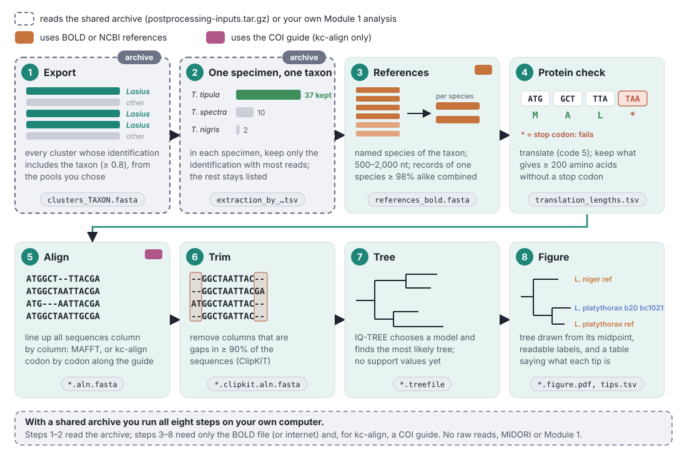

# Module 2 · Postprocessing

Module 2 works on **one taxon at a time** (for example the family Tipulidae). It
takes the clusters that Module 1 assigned to that taxon (consensus sequences and
single reads, already made per specimen), keeps the main identification of each
specimen, adds reference sequences of named species, and produces an alignment and
a draft tree for you to review.

> **If Module 1 used the Arthropoda-only database** (results named `…_sintaxARTH.tsv`):
> SINTAX can only choose among the names in its database, so reads from fungi, plants,
> vertebrates or bacteria were given an arthropod name, sometimes with high confidence
> at the higher ranks (phylum, class, order). A read selected for your taxon may
> therefore not be an arthropod at all. Check that local consensus sequences cluster
> with the BOLD references in the tree, and treat isolated long branches with
> suspicion. See the [MIDORI notes](../data/sintax/README.md#optional-an-arthropoda-only-database).

- [A. Get the inputs ready](#a-get-the-inputs-ready)
- [B. Run Module 2](#b-run-module-2)
- [C. Review the results](#c-review-the-results)
- [D. Technical reference](#d-technical-reference)

## A. Get the inputs ready

Activate the software from the project folder first:

```bash
cd ~/metabarcoding
conda activate taxonomy
```

### A.1 A completed Module 1 analysis

You need **either** your own Module 1 analysis **or** an archive someone shared with you.

**Your own analysis.** Module 1 printed its path at the end
(`Postprocessing --analysis-dir: …/analysis`). Check it is complete and see which
samples it contains:

```bash
ls data/read_processing/DATASET_run01/analysis/analysis.complete
python -c "import json; print(json.load(open('data/read_processing/DATASET_run01/analysis/analysis_parameters.json'))['analysed_folders'])"
```

**A shared archive** (`postprocessing-inputs.tar.gz`). Save it in Downloads, check you
have about four times its size free (`df -h ~`), then extract it **in the project folder**
(not inside `data/`):

```bash
cd ~/metabarcoding
tar --keep-old-files -xzf "/mnt/c/Users/USERNAME/Downloads/postprocessing-inputs.tar.gz"
```

If the archive came in parts, join them first:
`cat postprocessing-inputs.tar.gz.part-* > postprocessing-inputs.tar.gz`.
`--keep-old-files` refuses to overwrite existing files; if it reports a collision,
use a fresh project folder. No path editing is needed: an analysis records its files
relative to the project folder. The sender tells you the analysis path to use.

### A.2 Reference sequences: BOLD or NCBI

| Option | Needs | Choose it when |
| --- | --- | --- |
| `--bold` (recommended for COI) | A prepared BOLD file in `data/bold/`: follow the [BOLD instructions](../data/bold/README.md). No internet during the run. | Usual COI analyses. |
| `--download` | Internet; downloads COI records from NCBI during the run. | BOLD lacks your group, or you need a numeric NCBI taxid. |

Only records with a **named species** are used from BOLD. The BOLD file also contains
other markers (16S, 28S, ITS, COI-3P, CYTB…), and every record whose header contains
your taxon name is selected, whatever its marker. The protein check (step 4 below)
removes most non-coding markers. **If you do not use kc-align with a COI guide,
records of other protein-coding markers can stay in the alignment and tree**; remove
them during review ([details](../data/bold/README.md#other-markers-in-the-bold-file)).

### A.3 A COI guide sequence for kc-align (recommended)

For COI, kc-align aligns codon by codon using one trusted COI sequence as a guide,
which gives a cleaner alignment than MAFFT. Prepare that guide by following
[Choosing a COI guide for kc-align](coi_reference.md). Without a guide, leave out the
`--kcalign` options and MAFFT is used.

## B. Run Module 2

Typical COI run with BOLD and kc-align:

```bash
python code/postprocess_sintax.py --bold --bold-db data/bold/BOLD_filtered.fasta.gz \
  --taxon Tipulidae --folders barcode01 barcode15 \
  --analysis-dir data/read_processing/DATASET_run01/analysis \
  --output-dir data/postprocessing/Tipulidae_b01_b15_run01 \
  --kcalign --kcalign-reference data/postprocessing/coi_refs/COI_reference.fasta \
  --threads 6
```

| Option | Meaning |
| --- | --- |
| `--taxon` | The taxon name exactly as it appears in the classification (any rank). With `--download` an NCBI taxid also works. |
| `--folders …` or `DATASET` | Which samples to use. Give the dataset name instead (e.g. `mergedseq5`) to use every analysed sample. |
| `--analysis-dir` | The Module 1 analysis folder. |
| `--output-dir` | A **new** folder for this run. |
| `--bold` / `--download`, `--bold-db` | Reference source (see A.2). Without `--bold-db`, every `.fasta.gz` file in `data/bold/` is read. |
| `--kcalign --kcalign-reference FILE` | Use kc-align with your COI guide. kc-align works in groups of three cores, so it uses the largest multiple of 3 not above `--threads` (e.g. 6 of 8). |
| `--skip-translation` | Skip the protein check; for non-coding markers (use MAFFT). |
| `--include-mitogenomes` | Keep whole-mitochondrial-genome reference records (removed by default). |
| `--threads` | Number of processor cores to use (default 8). Use fewer while another long job, such as Module 1 classification, is running. |

The run takes minutes to a few hours, mostly for alignment and the tree.

### What happens, step by step



1. **Export.** Clusters whose classification includes the taxon with confidence ≥ 0.8
   are exported from the chosen samples (`clusters_TAXON_DATE.fasta`). They were made
   in Module 1: reads of one specimen that are at least 97% identical form one
   consensus sequence; reads without a close partner stay single reads. Module 2
   does not cluster them again.
2. **One specimen, one taxon.** Clusters are grouped by barcode folder + forward tag
   (one specimen). Within each specimen, only the identification with the most reads
   is kept, with all its clusters; tied identifications are all kept. Example: 37
   reads *Tipula tipula*, 10 *T. spectra*, 2 *T. nigris* → the clusters of the 37
   *T. tipula* reads continue. The table `extraction_by_specimen_taxon.tsv` records
   every decision.
3. **References.** BOLD or NCBI records of the taxon are selected, whole-genome records
   removed, lengths outside 500–2,000 nt removed, and records of the same species
   that are at least 98% identical are combined. Different species are never combined.
4. **Protein check.** Each sequence (local cluster or reference consensus) must translate (genetic code 5, invertebrate
   mitochondrial) into at least 200 amino acids without a stop codon in one of its six
   reading frames. This removes many NUMTs (nuclear copies of COI) and other
   non-coding sequences, but not all.
5. **Alignment.** kc-align (with a guide) or MAFFT. kc-align may reject sequences with
   frameshifts or stop codons; `*.kcalign_selection.tsv` lists them.
6. **Trimming.** ClipKIT removes alignment columns that are gaps in 90% or more of
   the sequences (`gappy` mode).
7. **Tree.** IQ-TREE chooses a substitution model and estimates a
   maximum-likelihood tree, without bootstrap support.
8. **Figure.** Baltic draws the tree rooted at the midpoint, and
   `*.figure.tips.tsv` says what each tip is.

Reads without an assigned forward tag are grouped per barcode under the tag name
`none`. Such a group can mix specimens; treat its clusters with caution.

### If a run stops

Read the last lines of `postprocessing.log` in the run folder. After fixing the cause,
continue the same run:

```bash
python code/postprocess_sintax.py … the same options … --resume
```

`--resume` reuses every finished step whose inputs and settings are unchanged and
redoes the others, together with the steps that depend on them. You can change, for
example, the aligner or the COI guide and resume: only the alignment, trimming,
tree and figure are redone. Taxon, samples, analysis folder, reference source and
date cannot change; use a new output folder for those. Replaced files are moved to
`resume_archive/`.

## C. Review the results

The pipeline goes from alignment to tree without stopping. **Its tree is a draft
until you have checked the alignment.**

### C.1 Files to open first

`*` stands for the taxon and date, e.g. `combined_Tipulidae_nonumt_20261122`.

| File | What it is |
| --- | --- |
| `postprocessing.complete` | Present only when the whole run finished. |
| `*.figure.pdf` / `.png` / `.svg` | The tree picture. |
| `*.figure.midpoint.nwk` | The rooted tree, to open in Peartree. |
| `*.clipkit.aln.fasta` | The trimmed alignment the tree was built from: **check this**. |
| `*.aln.fasta` | The alignment before trimming. |
| `extraction_by_specimen_taxon.tsv` | Reads and clusters per specimen and identification, and which identification was kept. |
| `*.figure.tips.tsv` | What each tree tip is: local cluster or reference, with its IDs and read count. |
| `bold_reference_metadata.tsv` | Original BOLD process ID and header of each reference. |
| `postprocessing.log` | Every command run, counts and errors. |

Every file is described in the [output-file reference](../data/postprocessing/README.md).

### Reading the local sequence names

The line starting with `>` above each local sequence records where it came from:

```text
>barcode01-bc1009-Culicoides_punctatus_12345-nocontamination-37-0a1b2c3d-…
```

| Part | Meaning |
| --- | --- |
| `barcode01` | Sample folder. |
| `bc1009` | Forward tag (the specimen); `none` if no tag was assigned. |
| `Culicoides_punctatus_12345` | Lowest confidently assigned taxon; the number is the NCBI taxid, not a count. |
| `nocontamination` | Whether that taxon was flagged by Module 1's contamination screen. |
| `37` | Number of reads in the cluster (1 for a single read). |
| `0a1b2c3d-…` | The cluster ID: the read ID of the cluster's centroid (its longest read); it can contain hyphens. |

The first five hyphens separate the fields; hyphens inside a field are written `%2D`.
Do not rename sequences: the names link the tree back to Module 1. To see which reads
form a cluster, look up the cluster ID in
`DATASET/barcodeNN/filtered/cluster_members.tsv.gz`.

Reference headers look like `BOLD_000000123__taxon__Tipula_maxima` or
`AB123456.1__taxon__Tipula_maxima`; look them up in `bold_reference_metadata.tsv` or
`reference_records.gb.xml`.

### C.2 Check the alignment in UGENE

1. Install [UGENE](https://ugene.net/download-all.html) on Windows (not in Conda).
2. **File → Open** the `*.clipkit.aln.fasta` file. If asked, open it as an alignment
   and keep the gaps. A project under `~` is found in Windows Explorer under
   `\\wsl$\Ubuntu\home\YOUR_LINUX_NAME\metabarcoding`.
3. Scroll through the whole alignment. Look for: blocks that do not line up,
   sequences full of gaps or ambiguous letters, very short sequences, unexpected
   insertions or deletions, sequences that look unrelated (possibly another marker
   from BOLD, or a NUMT), and odd sequence ends.
4. Save any edited alignment under a **new name** outside the run folder, for example
   `data/final/coi_aln_v01.fasta`, then `v02` for the next round. Keep notes of every
   removed sequence and why in `data/final/README.md`.

Which reads, consensuses and reference species to keep is **your scientific
decision**. Base it on sequence quality, identification reliability, possible NUMTs,
overlap and marker. A single read keeps all its sequencing errors; a consensus of
many reads is more reliable. Do not edit `kept_for_tree` in the extraction table: it
records what the pipeline did, it does not control it.

### C.3 Estimate the final tree with bootstrap support

After reviewing the alignment, estimate the tree again from your reviewed copy, this
time with 1,000 ultrafast bootstrap replicates:

```bash
mkdir -p data/final
iqtree -s data/final/coi_aln_v01.fasta -m MFP -B 1000 --bnni -T 6 --seed 666 \
  --prefix data/final/coi_aln_v01_run01
```

Use a new `--prefix` for every estimation you want to keep. The result is
`coi_aln_v01_run01.treefile` (with support values) and `.contree` (consensus tree);
`.iqtree` reports the model. Support values measure branch stability, not
correctness of identifications. See the
[IQ-TREE documentation](https://iqtree.github.io/doc/Command-Reference#ultrafast-bootstrap-parameters).
`--resume` of Module 2 does not use your edited alignment.

### C.4 Look at the tree

Open [Peartree](https://peartree.live/) in a browser and load `*.figure.midpoint.nwk`
(or your final `.treefile`). Remember:

- A local tip is one cluster of a specimen: a consensus of reads or a single read.
  A specimen can give several tips.
- Branch lengths are DNA substitutions per site, not time.
- The midpoint root is a drawing choice, not the true ancestor.
- A local tip next to a reference species is evidence, not proof, of identity.

For custom figures in Python, use [Baltic](https://phylo-baltic.github.io/baltic-gallery/)
(already installed), or re-draw a tree with `python code/plot_phylogeny.py --help`.

## D. Technical reference

### Clustering

Local reads are clustered in Module 1 (`cluster_specimens.py`): VSEARCH
`--cluster_fast --iddef 2 --strand both --id 0.97` per barcode + forward tag, on all
cleaned reads of the specimen before classification. Module 2 clusters only the
references: the same command with identity 0.98, per species label. Consensus
sequences come from `--consout`; they are named after their centroid.

### Protein check (`--min-aa`)

SeqKit translates every sequence in all six frames with `--translation-table`
(default 5). A sequence passes when one frame has at least `--min-aa` (default 200)
consecutive amino acids without a stop (`*`) or unknown (`X`) residue.
`translation_lengths.tsv` lists, per
frame, the translation length and the longest stop-free stretch. 200 amino acids are
600 nt, and the primer-trimmed barcode region is about 658 nt, so a sequence passes
only when nearly all of it is one uninterrupted reading frame: most frameshifts and
internal stop codons make it fail.

### Alignment

MAFFT (default): `mafft --retree 2 --maxiterate 0 --adjustdirectionaccurately`
(FFT-NS-2) with MAFFT's default gap penalties. Sequences MAFFT reverse-complemented
are recorded in `alignment_orientation.tsv`.

kc-align: mixed mode with the guide, genetic code `--translation-table`. The guide
itself is not a tip. Two local helpers (`kcalign_cli.py`, `kcalign_parallel.py`) fix
thread handling and a crash when kc-align rejects a read in the installed version;
the biological checks are unchanged. kc-align and its fallback aligners (Kalign,
MAFFT) must be installed.

### Trimming

`clipkit ALIGNMENT -m gappy -s nt`: removes columns with a gap fraction ≥ 0.9. Columns
are removed from all sequences together; single sequences are never shortened
individually. A sequence left with no bases at all (it only covered removed columns,
for example a reference of another COI region) is dropped and named in
`postprocessing.log`, because IQ-TREE cannot use it. The untrimmed alignment is kept.

### Tree and figure

`iqtree -m MFP --seed 666` on the trimmed alignment, no bootstrap. At least four
sequences must remain. The figure is midpoint-rooted with Baltic; tip labels are
*taxon | folder | forward tag | reads in the cluster* for local clusters, *organism | accession*
for NCBI and *species | process ID* for BOLD references.

### Resume rules

`checkpoints.json` records, for each step, its output checksums, its inputs (size and
modification time) and its settings. With `--resume` a step is reused only if all three
match. `parameters.json` holds the original options, `resume_parameters.json` those of
the latest resume.
