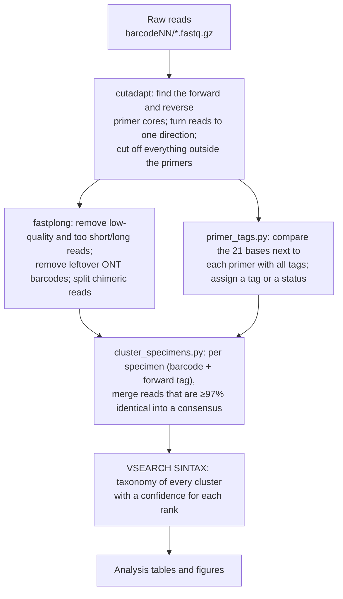
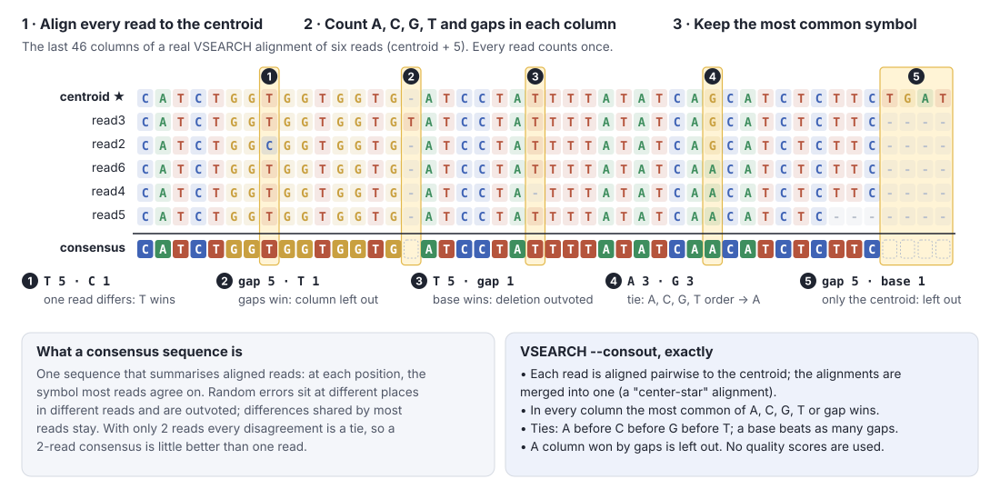

# Module 1 · Read processing

The project sequences COI from individually processed arthropods collected from
deadwood: each PCR well holds one specimen, and each well is marked by its tagged
forward primer. Module 1 takes the raw reads of every barcode folder in a
sequencing run and works out which specimen each read comes from (its tags),
cleans the reads, groups the nearly identical reads of each specimen into
clusters, and identifies every cluster taxonomically. It then summarises the
results per specimen, species and sample, and flags taxa that appear in almost
every sample (possible contamination).

Before starting, complete the [setup](setup.md) and download the
[MIDORI database](../data/sintax/README.md).

## What you need

| Input | Where it goes | Notes |
| --- | --- | --- |
| Raw reads | `data/DATASET/barcodeNN/*.fastq.gz`, plus optional `data/DATASET/unclassified/` | One folder per ONT barcode, files directly inside it as written by MinKNOW. `DATASET` is any name you like, e.g. `mergedseq5`. |
| Tagged primers | `data/PCRsaproxdna_primertags_seq5_2026_1.fasta` | One record per primer: `bcXXXX` = forward, `bcXXXXrc` = reverse. Each sequence is a 5-nt `GGTAG` spacer, a 16-nt tag, then the primer. Must match your laboratory protocol. |
| ONT barcodes | `data/ONT_24_native_barcode_sequences.fasta` | The native barcode sequences removed by fastplong. |
| MIDORI database | `data/sintax/` | See the [MIDORI instructions](../data/sintax/README.md). |

### If MinKNOW wrote pass/fail subfolders

If reads sit in `barcode01/pass/` and `barcode01/fail/` (or `fastq_pass/barcode01/` …),
combine them first. The originals are kept; a single `pass_fail_merged.fastq.gz` is
written into each sample folder. Failed reads are included on purpose: Module 1
applies its own quality filter.

```bash
python code/merge_pass_fail.py DATASET --dry-run   # shows what would be combined
python code/merge_pass_fail.py DATASET
```

## Run it

```bash
cd ~/metabarcoding
conda activate taxonomy
python code/read_processing.py DATASET --dry-run
python code/read_processing.py DATASET --output-dir data/read_processing/DATASET_run01
```

The dry run lists, per sample, whether reads will be cleaned and classified or
whether existing results will be reused. Without `--output-dir` the analysis goes to
`data/read_processing/DATASET_<date>_<time>`. The analysis folder must be new.

Settings (error limits, thread counts, filters) are all in
[`config/pipeline.env`](../config/pipeline.env), each with a comment. To change one
for a single run, put it in front of the command, for example
`MAX_JOBS=2 python code/read_processing.py …`.

**How long it takes:** finding primers and tags takes 1–2 minutes per 500,000 raw
reads. Quality filtering takes about 15–30 minutes for the same number, almost all of
it spent searching for ONT barcodes inside reads. Clustering takes a few minutes.
Classification (SINTAX) is far slower: about one second per sequence on 8 threads.
Because the clusters are classified instead of every read, a sample needs roughly a
third of the time it used to: in a test on barcode15 of mergedseq5 (164,178 cleaned
reads), clustering left 58,631 sequences, and classification went from about 44 to
about 16 hours.

## What happens to each sample



1. **Primers.** cutadapt looks for the forward primer core
   (`RKTCAACMAATCATAAAGATATTGG`) and the reverse primer core
   (`TAAACTTCWGGRTGWCCAAAAAATCA`, found as its reverse complement at the other end).
   It understands degenerate bases (R, K, M, W…) and allows up to
   `PRIMER_CORE_MAX_ERRORS` = 5 errors per core. Reads that face the wrong way are
   reverse-complemented, so all output reads have the same direction. The primers,
   tags and everything beyond them (adapters, barcodes) are cut off.
2. **Tags.** See [How tags are identified](#how-tags-are-identified).
3. **Quality filter.** fastplong removes reads with mean quality below 6, too many
   low-quality bases, or a length outside 300–1,900 nt. It removes remaining ONT
   barcode sequences and splits reads that contain an internal adapter (chimeras);
   the pieces are named `chimera-segment-1-…`, `chimera-segment-2-…` (older fastplong
   versions: `split-by-adapter-left-…`/`-right-…`).
4. **Clustering.** The cleaned reads of each specimen (one barcode folder + one
   forward tag) are clustered with VSEARCH: reads that are at least 97% identical
   form a cluster, and a cluster of two or more reads is replaced by its consensus
   sequence (at each position, the most common base). A read with no close partner
   stays as it is (a *single read*). Reads without an assigned forward tag are
   clustered together per barcode folder, as specimen `none`. 97% keeps closely
   related species apart; do not lower it.
5. **Classification.** VSEARCH SINTAX compares every cluster (consensus or single
   read) with the MIDORI COI database and reports, for each rank from kingdom to
   species, a name and a confidence between 0 and 1. Every read of a cluster gets
   the cluster's identification.

Why clustering first: the reads of one specimen are mostly copies of the same
sequence, so classifying each of them repeats the same work. In the barcode15 test,
classifying clusters found 338 of the 344 species found by classifying every read
(the 6 missed species had 10 reads together), all 157 species with 10 or more reads,
and the same main species for 92 of 95 specimens. Consensus sequences have fewer
sequencing errors than single reads, so more reads reached a species name (70,508
instead of 66,430).

Tags are identified on the raw reads, before fastplong, because fastplong's adapter
removal would cut into the tags.

### How clustering works

Clustering uses only the COI region between the primers: the ONT barcodes, tags and
primers were cut off before. The tags were read first and decide the specimen, so
only reads of the same barcode folder + forward tag are ever compared.


VSEARCH (`--cluster_fast --id 0.97 --iddef 2`) works through the reads of one
specimen from the longest to the shortest:

1. The first read becomes the **centroid** of the first cluster.
2. Each next read is compared with the centroids found so far. VSEARCH first ranks
   them by the number of 8-letter words they share with the read, then aligns the
   read to the best candidates. **Identity** is the number of identical columns
   divided by the number of aligned columns, not counting gaps at the ends.
3. The read joins the first centroid it matches with at least 97% identity
   (VSEARCH stops after one match, or after 32 centroids that do not match).
   If none matches, the read becomes the centroid of a new cluster.

Each cluster is named after its centroid: `cluster_id` is that read's ID. Because
the centroid is the longest read, it is often one whose end was not trimmed (for
example 712 instead of 658 nt); the consensus leaves such extra ends out.

A cluster of two or more reads is replaced by its **consensus sequence**. A read that
matches no centroid stays a cluster of one, a **single read**: mostly reads with more
than about 3% sequencing errors, sometimes a rare real variant, another organism, a
chimera or a NUMT. Single reads are classified as they are, with their errors.



The consensus (`--consout`) is built from an alignment of every read of the cluster
to its centroid. In each column, VSEARCH counts A, C, G, T and gaps, one vote per
read (quality scores are not used), and keeps the most common symbol. Ties between
bases go to A, then C, G, T; a base beats an equal number of gaps; a column won by
gaps is left out. So a random error in one read is outvoted, an extra base in a
minority of reads disappears, and a missing base in a minority of reads is restored.
With only two reads, every disagreement is a tie and the consensus is barely better
than a single read; trust it by its read count.

## How tags are identified

Each primer starts with a 21-base **tag block** (`GGTAG` spacer + 16-base tag). After
cutadapt has found a primer core, the bases next to it are compared with every
known tag block, allowing substitutions, insertions and deletions (an *edit
distance*). The result for each read end is one of:

| Status | Meaning | Tag reported? |
| --- | --- | --- |
| `assigned` | The best tag has at most `TAG_MAX_ERRORS` = 4 errors, and the second-best tag has at least `TAG_MIN_MARGIN` = 2 more errors. | yes |
| `ambiguous` | Two or more tags fit almost equally well (less than 2 errors apart). The candidates are listed in `*_tag_candidates`. | no |
| `too_many_errors` | Even the best tag has more than 4 errors, e.g. a damaged tag or a primer used without a tag. | no |
| `truncated` | The read starts or ends inside the tag block, so fewer than `TAG_MIN_OBSERVED` = 21 tag bases are present. | no |
| `primer_not_found` | cutadapt found no primer core at this end. | no |

Why these limits: forward tags differ from each other at as few as 5 positions, so a
tag with more than 4 errors could be confused with another one. ONT reads often
contain insertions and deletions, so a comparison that only counts mismatches
(as the old pipeline did) shifts out of register and picks the wrong tag. In a test
on 15,793 barcode01 reads the old method disagreed with this one for 5.6% of
forward tags, and the disagreeing calls were the old method's errors.

**About the 16-error limit used previously:** the old setting allowed 16 mismatches
over the whole 46-base primer, partly because seqkit counted every degenerate base
as a mismatch. cutadapt handles degenerate bases correctly, so the primer core gets
its own limit (5), and the tag block its own (4). Allowing many more core errors is
unsafe: in a test with 12, cutadapt "found" primers at random positions in every
read and cut away 98% of the sequence.

## Results

### Files next to the raw reads (per sample)

| File | Contents |
| --- | --- |
| `barcodeNN/filtered/asinput.fastq.gz` | Cleaned, primer-free, quality-filtered reads. |
| `barcodeNN/filtered/clusters.fasta` | One sequence per cluster: the consensus, or the read itself for a single read. Named after the cluster's centroid (its longest read). This is what SINTAX and Module 2 use. |
| `barcodeNN/filtered/cluster_members.tsv.gz` | One row per cleaned read: `read_id`, `cluster_id`, `forward_tag`. |
| `barcodeNN/filtered/primer_tags.tsv.gz` | One row per **raw** read: direction, and for each end the tag name, status, core errors, tag errors, margin to the second-best tag and (if ambiguous) the candidates. |
| `barcodeNN/filtered/fastplong.html`, `fastplong.json` | fastplong's quality report. |
| `barcodeNN/filtered/logs/` | cutadapt, tag-scoring, fastplong and clustering logs. |
| `data/sintax/DATASET/barcodeNN/barcodeNN_sintaxARTH.tsv` | SINTAX output, one line per cluster (`sintaxSP` when the full MIDORI database was used). |

### The analysis folder (`…/analysis/`)

| File | Contents |
| --- | --- |
| `specimen_taxa.tsv` | **Start here.** For every specimen (barcode folder + forward tag), each identification with its reads and clusters, the share of the specimen's reads, and `largest_taxon` = `True` for the identification with most reads. With one arthropod per well, the largest taxon is usually the specimen; the others are contamination, gut contents, parasites or errors. |
| `barcodeNN/barcodeNN_clusters.tsv` | One row per cluster (columns below). |
| `all_species_summary.tsv` | One row per species per sample: reads, clusters, specimens and forward tags in which it was found, median confidence, higher ranks, contamination flag. |
| `species_by_folder.tsv` | Reads per species (columns) and sample (rows), for ecological analyses. |
| `barcode_analysis_summary.tsv`, `barcode_assignment_counts.png` | Per sample: raw and cleaned reads, specimens, clusters, consensus sequences, single reads, and reads identified to any rank, genus and species. |
| `primer_tag_summary.tsv`, `primer_tag_status.png` | Per sample and primer end: how many raw and cleaned reads got each tag status. Check this first: a low `assigned` share points to a primer or tag problem. |
| `taxon_barcode_prevalence.tsv` | The contamination screen (below): in how many barcode folders each taxon was found. |
| `barcodeNN/barcodeNN_species_read_counts.png` | The 25 species with most reads in the sample. |
| `analysis_parameters.json` | The settings and the exact input files (with their sizes) used. |
| `analysis.complete` | Written last. Module 2 only accepts an analysis with this file. |

Open `.tsv` files in a spreadsheet and choose **Tab** as the separator.

**Columns of `barcodeNN_clusters.tsv`:**

| Column | Meaning |
| --- | --- |
| `cluster_id` | Name of the cluster: the read ID of its centroid (its longest read). |
| `cluster_type` | `consensus` (two or more reads) or `single_read`. |
| `read_count` | Number of cleaned reads in the cluster. |
| `forward_tag` | The specimen's forward tag; `none` when the reads had no assigned forward tag. |
| `reverse_tags` | Reverse tags found among the cluster's reads. |
| `assigned_rank`, `assigned_label`, `assigned_name`, `assigned_taxid`, `assigned_confidence` | The identification: the lowest rank accepted (confidence ≥ 0.8), its MIDORI label, the name and NCBI taxid, and the confidence. Empty when no rank was accepted. |
| `contamination` | `contamination` when the identification is a taxon flagged by the contamination screen. |
| `kingdom` … `species` | The name at each rank, only when that rank was accepted. |
| `kingdom_confidence` … `species_confidence` | SINTAX's confidence at each rank, also when below 0.8. |
| `strand`, `sintax_taxonomy` | SINTAX's strand and its full output, including names below 0.8. |

### Confidence and identification

SINTAX reports a confidence for every rank. A rank is **accepted** when its confidence
is at least 0.8 (`ANALYSIS_CUTOFF` in the settings). The **identification** of a
cluster is its lowest accepted rank (for example the genus, if species is below 0.8).
Confidences are SINTAX bootstrap values, not probabilities.

### Contamination screen

A taxon (at any rank) is flagged `contamination` when it is confidently found in at
least 80% of the barcode folders analysed (`PREVALENCE`; `unclassified` is not
counted). For 21 barcodes that means 17 or more. This is only a warning sign:
widespread deadwood arthropods and broad ranks such as *Insecta* are naturally
found everywhere.

### Read counts

Every count of reads is the number of cleaned reads in the clusters concerned. A raw
read split by fastplong into two pieces counts twice. Tags are looked up for the raw
read, so both pieces carry the same tags.

## When results already exist

The pipeline reuses finished work:

- A sample is cleaned again only when `filtered/asinput.fastq.gz` or
  `filtered/primer_tags.tsv.gz` is missing, or with `FORCE=1`.
- A sample is clustered again when `filtered/clusters.fasta` is missing or older than
  the cleaned reads.
- A `filtered/` folder made by an older pipeline version is not overwritten
  automatically: the run stops and asks for `FORCE=1`.
- A sample is classified again when its SINTAX output is missing or older than its
  clusters, or with `FORCE_SINTAX=1`.
- `CLEAN_ONLY=1` stops after cleaning and clustering, without classification.
- The analysis tables are always written to a new folder.

To redo only the tables (for example with another prevalence threshold) without
cleaning or classifying:

```bash
python code/sintax_analysis.py DATASET --output-dir data/read_processing/DATASET_tables02 --prevalence 0.9
```

## Export sequences

`export_clusters.py` reads a completed analysis and writes the cluster sequences
(consensus sequences and single reads) to a FASTA file. Each sequence name says
where it came from (see
[Reading the sequence names](post_processing.md#reading-the-local-sequence-names)).

**All clusters of a taxon** (any rank, confidence ≥ 0.8 at that rank):

```bash
python code/export_clusters.py --taxon Tipulidae \
  --analysis-dir data/read_processing/DATASET_run01/analysis \
  --folders barcode01 barcode15 --output data/exports/Tipulidae_b01_b15.fasta
```

**All clusters of one specimen** (forward tag), here in one barcode folder:

```bash
python code/export_clusters.py --tag bc1087 --folders barcode15 \
  --analysis-dir data/read_processing/DATASET_run01/analysis \
  --output data/exports/barcode15_bc1087.fasta
```

Repeat `--taxon` or `--tag` to export several together; give both to export, for
example, only the Tipulidae clusters of one specimen. Leave out `--folders` to use
every analysed sample. The read count of each cluster is in its name and in
`barcodeNN_clusters.tsv`.

**The reads of one cluster.** `cluster_members.tsv.gz` lists every cleaned read with
the cluster it belongs to. Copy the cluster ID from `barcodeNN_clusters.tsv` (or from
a sequence name in Module 2), list its reads, and extract them from the cleaned reads:

```bash
F=data/DATASET/barcode20/filtered
CLUSTER=a3a699ce-677b-422d-9c81-11f2b17e61fc
zcat "$F/cluster_members.tsv.gz" | awk -F'\t' -v c="$CLUSTER" '$2 == c {print $1}' > "$CLUSTER.reads.txt"
seqkit grep -f "$CLUSTER.reads.txt" "$F/asinput.fastq.gz" -o "$CLUSTER.reads.fastq.gz"
seqkit grep -p "$CLUSTER" "$F/clusters.fasta" > "$CLUSTER.consensus.fasta"
```

The first file has one read ID per line; the second holds the cleaned reads (primers
already removed), the third the consensus sequence itself. To see the tags of those
reads, look them up in `primer_tags.tsv.gz` (split reads appear there under the ID
of the raw read they came from).

## Next step

Continue with [Module 2 · Postprocessing](post_processing.md).
