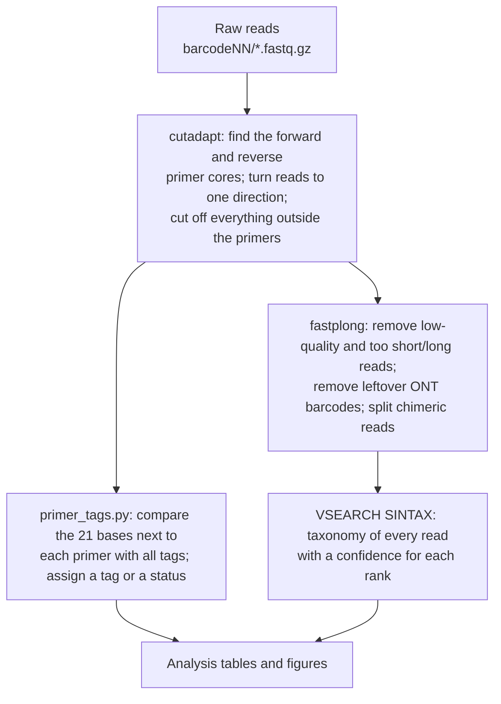

# Module 1 · Read processing

Module 1 takes the raw reads of every barcode folder in a sequencing run and
produces, for each read: which tagged primers it carries, a cleaned and
primer-free sequence, and a taxonomic identification. It then summarises the
results per sample and flags taxa that appear in almost every sample (possible
contamination).

Before starting, complete the [setup](setup.md) and download the
[MIDORI database](../data/sintax/README.md).

## What you need

| Input | Where it goes | Notes |
| --- | --- | --- |
| Raw reads | `data/DATASET/barcodeNN/*.fastq.gz`, plus optional `data/DATASET/unclassified/` | One folder per ONT barcode, files directly inside it as written by MinKNOW. `DATASET` is any name you like, e.g. `mergedseq5`. |
| Tagged primers | `data/PCRsaproxdna_primertags_seq5_2026_1.fasta` | One record per primer: `bcXXXX` = forward, `bcXXXXrc` = reverse. Each sequence is a 5-nt `GGTAG` spacer, a 16-nt tag, then the primer. Must match your laboratory protocol. |
| ONT barcodes | `data/ONT_24_native_barcode_sequences.fasta` | The native barcode sequences removed by fastplong. |
| MIDORI database | `data/sintax/` | See the [MIDORI instructions](../data/sintax/README.md). |

### If MinKNOW wrote pass/fail subfolders

If reads sit in `barcode01/pass/` and `barcode01/fail/` (or `fastq_pass/barcode01/` …),
combine them first. The originals are kept; a single `pass_fail_merged.fastq.gz` is
written into each sample folder. Failed reads are included on purpose: Module 1
applies its own quality filter.

```bash
python code/merge_pass_fail.py DATASET --dry-run   # shows what would be combined
python code/merge_pass_fail.py DATASET
```

## Run it

```bash
cd ~/metabarcoding
conda activate taxonomy
python code/read_processing.py DATASET --dry-run
python code/read_processing.py DATASET --output-dir data/read_processing/DATASET_run01
```

The dry run lists, per sample, whether reads will be cleaned and classified or
whether existing results will be reused. Without `--output-dir` the analysis goes to
`data/read_processing/DATASET_<date>_<time>`. The analysis folder must be new.

Settings (error limits, thread counts, filters) are all in
[`config/pipeline.env`](../config/pipeline.env), each with a comment. To change one
for a single run, put it in front of the command, for example
`MAX_JOBS=2 python code/read_processing.py …`.

**How long it takes:** finding primers and tags takes 1–2 minutes per 500,000 raw
reads. Quality filtering takes about 15–30 minutes for the same number, almost all of
it spent searching for ONT barcodes inside reads. Classification (SINTAX) is far
slower: about one read per second on 8 threads, which is hours to weeks per sample.

## What happens to each sample



1. **Primers.** cutadapt looks for the forward primer core
   (`RKTCAACMAATCATAAAGATATTGG`) and the reverse primer core
   (`TAAACTTCWGGRTGWCCAAAAAATCA`, found as its reverse complement at the other end).
   It understands degenerate bases (R, K, M, W…) and allows up to
   `PRIMER_CORE_MAX_ERRORS` = 5 errors per core. Reads that face the wrong way are
   reverse-complemented, so all output reads have the same direction. The primers,
   tags and everything beyond them (adapters, barcodes) are cut off.
2. **Tags.** See [How tags are identified](#how-tags-are-identified).
3. **Quality filter.** fastplong removes reads with mean quality below 6, too many
   low-quality bases, or a length outside 300–1,900 nt. It removes remaining ONT
   barcode sequences and splits reads that contain an internal adapter (chimeras);
   the pieces are named `chimera-segment-1-…`, `chimera-segment-2-…` (older fastplong
   versions: `split-by-adapter-left-…`/`-right-…`).
4. **Classification.** VSEARCH SINTAX compares every cleaned read with the MIDORI COI
   database and reports, for each rank from domain to species, a name and a
   confidence between 0 and 1.

Tags are identified on the raw reads, before fastplong, because fastplong's adapter
removal would cut into the tags.

## How tags are identified

Each primer starts with a 21-base **tag block** (`GGTAG` spacer + 16-base tag). After
cutadapt has found a primer core, the bases next to it are compared with every
known tag block, allowing substitutions, insertions and deletions (an *edit
distance*). The result for each read end is one of:

| Status | Meaning | Tag reported? |
| --- | --- | --- |
| `assigned` | The best tag has at most `TAG_MAX_ERRORS` = 4 errors, and the second-best tag has at least `TAG_MIN_MARGIN` = 2 more errors. | yes |
| `ambiguous` | Two or more tags fit almost equally well (less than 2 errors apart). The candidates are listed in `*_tag_candidates`. | no |
| `too_many_errors` | Even the best tag has more than 4 errors, e.g. a damaged tag or a primer used without a tag. | no |
| `truncated` | The read starts or ends inside the tag block, so fewer than `TAG_MIN_OBSERVED` = 21 tag bases are present. | no |
| `primer_not_found` | cutadapt found no primer core at this end. | no |

Why these limits: forward tags differ from each other at as few as 5 positions, so a
tag with more than 4 errors could be confused with another one. ONT reads often
contain insertions and deletions, so a comparison that only counts mismatches
(as the old pipeline did) shifts out of register and picks the wrong tag. In a test
on 15,793 barcode01 reads the old method disagreed with this one for 5.6% of
forward tags, and the disagreeing calls were the old method's errors.

**About the 16-error limit used previously:** the old setting allowed 16 mismatches
over the whole 46-base primer, partly because seqkit counted every degenerate base
as a mismatch. cutadapt handles degenerate bases correctly, so the primer core gets
its own limit (5), and the tag block its own (4). Allowing many more core errors is
unsafe: in a test with 12, cutadapt "found" primers at random positions in every
read and cut away 98% of the sequence.

## Results

### Files next to the raw reads (per sample)

| File | Contents |
| --- | --- |
| `barcodeNN/filtered/asinput.fastq.gz` | Cleaned, primer-free, quality-filtered reads. This is what SINTAX and Module 2 use. |
| `barcodeNN/filtered/primer_tags.tsv.gz` | One row per **raw** read: direction, and for each end the tag name, status, core errors, tag errors, margin to the second-best tag and (if ambiguous) the candidates. |
| `barcodeNN/filtered/fastplong.html`, `fastplong.json` | fastplong's quality report. |
| `barcodeNN/filtered/logs/` | cutadapt, tag-scoring and fastplong logs. |
| `data/sintax/DATASET/barcodeNN/barcodeNN_sintaxSP.tsv` | SINTAX output, one line per cleaned read. |

### The analysis folder (`…/analysis/`)

| File | Contents |
| --- | --- |
| `barcodeNN/barcodeNN_reads.tsv` | **Main table.** One row per cleaned read: read IDs, tag names and statuses, every rank with its confidence, the accepted ranks, the assigned (lowest confident) taxon and contamination flags. |
| `barcodeNN/barcodeNN_species_summary.tsv` | One row per species: confident read count, median confidence, tags seen, contamination flag. |
| `barcodeNN/barcodeNN_primer_taxonomy.tsv` | Read counts per forward tag + reverse tag + assigned taxon. Use it to see which specimen gave which taxon. |
| `barcodeNN/figures/barcodeNN_species_read_counts.png` | The 25 most abundant species in the sample. |
| `all_species_summary.tsv`, `species_by_folder.tsv` | Species summaries for all samples together; `species_by_folder.tsv` has one column per species. |
| `barcode_analysis_summary.tsv`, `barcode_assignment_counts.png` | Per sample: raw reads, cleaned reads, reads with a confident assignment, reads with tags. |
| `primer_tag_summary.tsv`, `primer_tag_status.png` | Per sample and direction: how many reads got each tag status. Check this first: a low `assigned` share points to a primer or tag problem. |
| `taxon_barcode_prevalence.tsv`, `contamination_summary_by_folder.tsv` | The contamination screen (below). |
| `input_manifest.tsv`, `analysis_parameters.json`, `TABLE_HEADERS.md` | Which input files were used, the settings, and a list of the columns of every table. |
| `analysis.complete` | Written last. Module 2 only accepts an analysis with this file. |

Open `.tsv` files in a spreadsheet and choose **Tab** as the separator. The read
tables are large; filter them in Python or R rather than a spreadsheet if needed.

### Confidence and assigned taxon

SINTAX reports a confidence for every rank. A rank is **accepted** when its confidence
is at least 0.8. The **assigned taxon** is the lowest accepted rank (for example the
genus, if species is below 0.8). `taxonomy_status` is `taxapass` when that rank is genus
or species, otherwise `taxafail`. Confidences are SINTAX bootstrap values, not
probabilities.

### Contamination screen

A taxon (at any rank) is flagged `contamination` when it is confidently found in at
least 80% of the barcode folders analysed (`unclassified` is not counted). For 21
barcodes that means 17 or more. This is only a warning sign: widespread insects and
broad ranks such as *Insecta* are naturally found everywhere.

### Read counts

`read_count` counts cleaned reads. A raw read split by fastplong into two pieces
counts twice; `raw_read_count` counts each raw read once. Tags are looked up for the
raw read, so both pieces carry the same tags.

## When results already exist

The pipeline reuses finished work:

- A sample is cleaned again only when `filtered/asinput.fastq.gz` or
  `filtered/primer_tags.tsv.gz` is missing, or with `FORCE=1`.
- A `filtered/` folder made by an older pipeline version is not overwritten
  automatically: the run stops and asks for `FORCE=1`.
- A sample is classified again when its SINTAX output is missing or older than its
  cleaned reads, or with `FORCE_SINTAX=1`.
- The analysis tables are always written to a new folder.

To redo only the tables (for example with another prevalence threshold) without
cleaning or classifying:

```bash
python code/sintax_analysis.py DATASET --output-dir data/read_processing/DATASET_tables02 --prevalence 0.9
```

## Export reads

Both exporters read the completed analysis and write FASTA files whose headers say
where each read came from (see
[Reading the headers](post_processing.md#reading-the-local-read-headers)).

**All reads of a taxon** (any rank, confidence ≥ 0.8 at that rank):

```bash
python code/export_sintax_fasta.py --taxon Tipulidae \
  --analysis-dir data/read_processing/DATASET_run01/analysis \
  --folders barcode01 barcode15 --output data/exports/Tipulidae_b01_b15.fasta
```

Repeat `--taxon` to export several taxa together. Leave out `--folders` to use every
analysed sample.

**All reads of one specimen** (forward tag) in one barcode folder:

```bash
python code/export_primer_fasta.py --primer bc1087 --barcode barcode15 \
  --analysis-dir data/read_processing/DATASET_run01/analysis \
  --output data/primer_exports/barcode15_bc1087.fasta
```

This also writes `.reads.tsv` (one row per exported read, with its taxonomy) and
`.counts.tsv`. Add `--include-unclassified` to also search the `unclassified` folder.
Only reads whose forward tag status is `assigned` are exported.

## Next step

Continue with [Module 2 · Postprocessing](post_processing.md).
